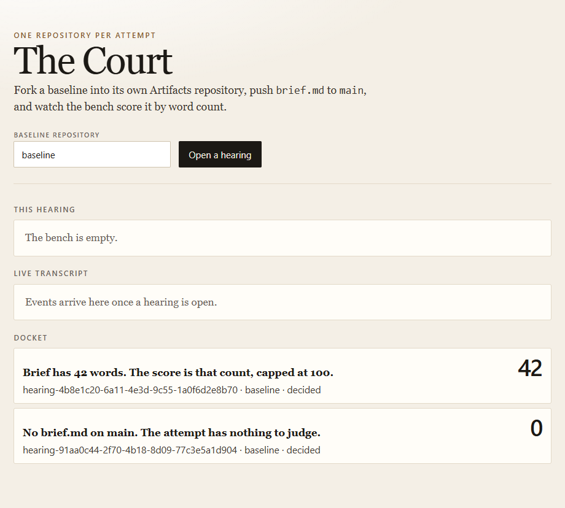
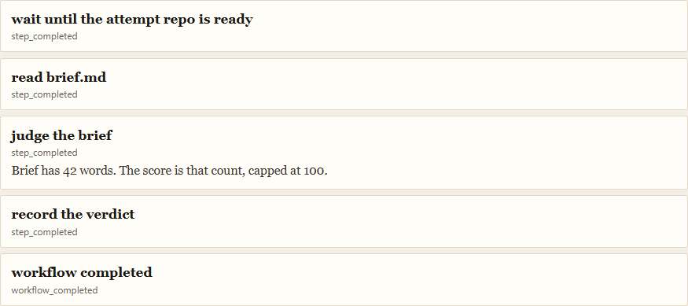
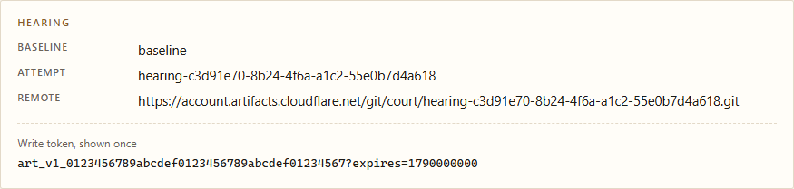

# The Court

The Court is a bench for people who run many agents against one baseline and need each attempt kept apart, scored, and visible while it happens.

An agent operator opens a hearing. The Court forks the baseline into a fresh Artifacts repository, hands that agent a Git remote and a write token, and waits for `brief.md` on `main`. A reviewer watches the docket. A team shipping the court itself keeps product changes on this Worker, where a branch is a Worker Preview. Attempt repositories never become those branches.



## Who it is for

- **Agent operators** running several attempts at once. Each hearing is its own repository, so one agent cannot push over another agent's work.
- **Reviewers** who want a verdict they can open, instead of a pile of worktrees. The docket lists the attempt, the score, and the sentence.
- **Teams adopting Artifacts** who want one working shape: a repository per attempt, and this Worker as the product those attempts report to.

The current judge counts words in `brief.md` and caps the score at 100. A 42-word brief scores 42. An attempt with no brief scores 0. That count needs no model key, so a hearing can finish today. The bench is the product. The sentence is whatever `judgeBrief` returns.

## Use cases

**Give each agent a private attempt.** Open a hearing against `baseline`. The agent receives a remote and a write token shown once, pushes `brief.md` to `main`, and leaves every other hearing untouched.

**Watch the hearing while it runs.** The workflow waits until the fork is readable, reads the brief, scores it, writes the report to R2, and records the row in D1. Those steps stream onto the transcript as they happen.



**Keep a docket.** Decided hearings stay listed with their score and verdict. The report for any hearing is at `/hearings/<id>/report`.

**Ship the court without shipping the attempts.** A branch of this repository is a preview of the product Worker. An attempt lives in the `court` Artifacts namespace. Changing the page, the judge, or the workflow is a product change. An agent's brief is not.

## Open a hearing

The baseline field already says `baseline`. The Worker creates that repository if it is missing, forks `hearing-<id>` from the default branch, and returns the Git remote with the write token.



Push `brief.md` to `main` with that token. The transcript follows the workflow from "the attempt repo is ready" through the verdict.

## Bindings

| Binding | Resource |
| --- | --- |
| `ARTIFACTS` | Artifacts namespace `court` |
| `DB` | D1 `the-court` |
| `BLOBS` | R2 `the-court-blobs` |
| `ROOM` | Durable Object `CourtRoom`, one room per hearing |
| `HEARING` | Workflow `the-court-hearing` |

`cf previews deploy` points those names at `court-preview`, `the-court-preview`, `the-court-blobs-preview`, and `the-court-hearing-preview`. Preview URLs are public until a self-hosted Access application covers this Worker and its preview deployments.

## Run

`cf dev` opens a remote session for the Artifacts binding, so the shell needs `CLOUDFLARE_API_TOKEN`.

```bash
cf dev
```

Open the printed URL.

```bash
curl -s localhost:8787/hearings \
  -H 'content-type: application/json' \
  -d '{"baseline":"baseline"}'
```

The response includes `remote` and `token`. Push the brief with that token, then watch `/hearings/<id>/live`.

## License

[MIT](LICENSE). Copyright 2026 OMADUDU N.V.
